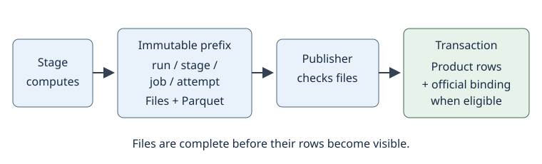
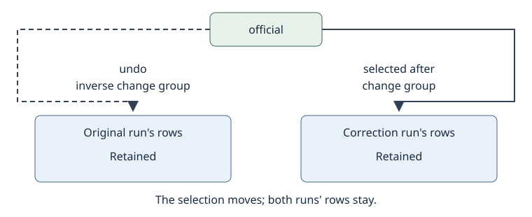

# Why the rebuild

The rebuild is `dev`'s science on a new operating foundation. The
reference and difference stages carry the algorithms in `dev`'s order:
awaicgen and SExtractor build and catalog the reference; ZOGY and SFFT
make the differences. The shipped settings carry `dev`'s defaults, with
measured changes recorded in dataset overlays. The socsims comparison
reproduces a team member's test window file for file, with close SFFT
SExtractor counts. What changes around that science is the record of
what ran, the write path, the quality gate, publication, the build and
the loop. Those changes give a scientist room to compare a correction
with the night's result, then choose which result the team uses.

## A corrected epoch can replace the night's result and come back out

A night has finished. A scientist inspects an epoch and finds that its
PSF needs retuning. In the familiar `dev` workflow, the replacement
passes through a version bump, the `vbest` selection flag,
re-registration and prune. Those are the team's existing terms for
making a new result and selecting it for downstream work. The
[migration](../system/migration) page maps those terms onto the rebuild.

In the rebuild, the scientist creates a new run with the retuned
setting and a reason for the experiment. The correction jobs name the
inputs they need, including the retained products from the night.
They publish their results alongside the original rows. The scientist
compares the candidate with the official result, then applies one
change group to make the chosen replacement products official. The
rest of the night keeps its existing selection. A correction confined
to downstream products can stay outside the live run and be selected
explicitly this way.

If the replacement is worse, `undo` applies the inverse change group.
Every published row of both runs remains available for comparison. The
team's queries through the `_official` views keep the same SQL and
follow the selected products. Their answers change with the selection;
the query interface stays unchanged. Undo checks that the bindings
still match the group being reversed, so a later correction is
protected from an older undo. This reverses the catalog selection;
packets already delivered to Kafka remain delivered.

## Each result carries the recipe and execution that made it

The [foundation](../system/foundation) gives the record its vocabulary.
A run is a recipe launched for a reason: who launches it, its code
revision, survey and dataset, and the complete resolved settings body.
Defaults, the dataset overlay and the experiment's overrides resolve
when the run is created. Their names and hashes stay with it. A
scientist comparing runs can therefore read the settings each actually
uses, even after the defaults change.

A job is an execution of a stage under that run, on a workstation or
on Batch. It records the scope, state, times and published attempt,
along with the image digest when it runs in an image. An attempt is a
try at that job. Every published product row names its job, which leads
back to the run. Executions over the same scientific key coexist. A
new measurement therefore has an identity of its own while the earlier
measurement remains readable.

In `dev` terms, `ProcReqs` and `reqid` map to the run; the product's
`version` maps to its producing job. The run's revision and settings,
the stage and the image digest carry the information associated with
`ppid`, `pipelines` and `swversions`. The familiar exposure, SCA and
filter remain scientific keys, with dataset included so simulations
and their source-injected variants have separate selections in the
same database.

Inputs are chosen at job launch and recorded by producing job. A stage
reads those named sets even if the official selection moves while it
computes. Association and packet history have a specific exception:
they read the applicable objects and history as execution reaches them,
and record exactly which sets they read. The record can answer which
reference made a difference and which histories a packet contains.
Comparison across runs uses source memberships, since object identities
can depend on the order in which epochs arrive.

## Publishing makes a complete result visible

A stage computes, then writes files and declared Parquet rows under an
immutable prefix containing the run, stage, job and attempt. It holds
no database connection during computation. The publisher checks the
files' checksums, loads the declared rows and records the published
attempt in a short transaction. For a live run, it also tries to bind
the outputs as official, provided the expected bindings still match.
A changed binding leaves the published rows as an unbound candidate,
with the reason on the job. Files are complete before their rows
become visible: this is publish-last.

Follow the write path from the stage's files to the publisher's rows
and conditional official binding.

Registration happens at this boundary for every stage. A failed attempt
can leave files under its own prefix; a later attempt writes elsewhere.
Once a job is published, another invocation stops before reading its
files. A catalog row's file reference therefore continues to identify
the bytes that produced that row.

## Official is a recorded choice among retained results

The `official` table holds the binding from a product's scientific key
to a job's rows. It also records which run is live for a survey and
dataset. Every opening and closing of a binding belongs to a change
group with an actor and reason. The group applies in one transaction;
`undo` records the inverse as another change. The `_official` views
join product rows to open bindings. Source memberships follow their
source set's selection, so object statistics follow the selected
memberships as well.

The diagram shows both runs' rows retained side by side: `official`
selects the correction, and `undo` moves the selection back to the
original through an inverse change group.

This is the role previously expressed through `vbest`, including the
human selection expressed by `vbest = 2`. A superseded source set's
memberships leave the official view while its rows stay in the record,
covering the selection work the team knows through prune. The
[measured replacement](../system/foundation.md#measurements) changed
four keys in 12.1 ms; its undo took 8.9 ms. The scientific products
remain in place throughout that change.

## The operating path is exercised as well as the science

Each commit used on Batch has its own image and job-definition
revision. The job row records the image digest, tying the result to
the executable build. The [procedure proof](../system/foundation.md#the-procedure-proof)
in CI checks cutover and undo through the official views, publication
interrupted around its commit, and competing changes to the same
binding. Steps needing real stages are exercised on SMDC. The local
entry point uses that pipeline image too: [day one](day-one) describes
an epoch taking about five minutes against a throwaway database. A
scientist can start with the same packaged environment used for Batch.

The [loop](../system/loop) carries a selected dataset from its source
root to the topic. It discovers ready work, submits jobs to Batch,
checks their outcomes and publishes eligible packet sets until the
selection drains. On the HLWAS F146 ramp, every pointing's SCA 8,
312 epochs, drained in 42.8 min with 1,300 jobs and no failed job.
Association now runs within the difference job; packet jobs can proceed
independently. The loop supplies the progression that lets a scientist
leave a selected run working without advancing each stage.

The [quality gate](../system/foundation.md#the-quality-gate) separates
having a product from sending it. It reads measured coverage,
registration, source counts and stellar residuals against the run's
bounds. On the injected footprint it held one set in 162 for a ring
fraction of +0.016. A held set remains official and available for
inspection, with its reason recorded, while the stream waits for
acceptable results. The gate judges available measurements after the
minimum epoch count; a metric that cannot be computed holds nothing.
Those limits matter when interpreting a successful send.

[Kafka publication](../system/foundation.md#publication-to-kafka)
follows database publication and the gate. Each packet is a
self-contained Avro message; acknowledgements precede the job's stamp
of partition and offsets. The consumer check reads those recorded
ranges and compares payloads with the stored output. A recorded check
over 33,650 packets took 388 s. The loop recovers an eligible set left
unsent after database publication. A crash after acknowledgement but
before the stamp can cause a replay, so consumers tolerate repeated
packets.

The [retry contract](../system/foundation.md#a-job-on-batch) distinguishes
a temporary dependency failure from a fault the same execution would
repeat. In the measured outage test, an unreachable database produced
exit 75 on three attempts over 33 s; a bad parameter tree produced
exit 64 once. Batch retries the transient case and container start
failures. Publish-last makes a retry after a late commit safe: the job
is already published, or the next attempt gets a fresh prefix. The
job record keeps the failure code and reason for diagnosis.

The fleet remains AWS Batch on SMDC, with PostgreSQL and spatial SQL
behind the catalog. The official views preserve access to the q3c and
GIN indexes used by the team's query shapes. At the initial measured
database size of 239 MB, all 23 statements in `database/queries.sql`
ran under 30 ms. That is a measurement at that size. Stage-specific
memory requests let Batch place small jobs alongside difference jobs,
and the recorded instance type makes execution comparisons possible.
The [foundation measurements](../system/foundation.md#measurements)
state the tested scale.

## The socsims comparison puts the new path beside familiar science

[Run 158](../log/2026-10-27-socsims-1021) processes the same 1,998
files as a team member's 2026-10-21 socsims test. Every image has a
published SFFT difference and packet set. Positive SFFT SExtractor
counts total 146,053,130 against 145,903,083, within 0.1%; the
image-by-image median count ratio is 1.000 for both signs. PSF-fit
counts are about 15% higher per image. The report identifies differing
PSFs and reference tie-breaks, while leaving the cause of the PSF-fit
excess unverified. This is a measured comparison with explicit
remaining differences.

The gate holds 1,997 of the 1,998 packet sets, chiefly for bright-star
core residuals beyond the bounds derived on HLWAS. One set, containing
396 packets, reaches Kafka and passes the consumer check. Holding the
other sets is the gate doing its assigned work: retain the science
products for investigation and keep out-of-bounds sets off the stream.

## The team's commissioning work determines the next choices

`dev` brings the team's daily operating experience. Applying that
experience to the rebuild means inspecting the residuals, choosing
production bounds and comparing the science on commissioning data.
The [flight-data sample](../system/datasets.md#flight-data-program-1049)
already runs through the chain with DQ masking; the broader
commissioning comparison and the move of the flight stream remain team
work. The mask derives from commissioning's rule, with the measured
SATURATED-bit exception recorded in [measurements](../system/measurements.md#the-dq-mask-at-intake).

Real/bogus work also has a starting point: the
[scoring ruling](../system/decisions.md#decision-reliability-scored)
records the port of `dev`'s RuBR-AT model for SFFT, with scores carried
to packets and no selection cut on the score. Team validation and the
choice of scoring cuts remain part of adopting it; ZOGY remains
unscored because the model is SFFT-trained. The
[migration questions](../system/migration.md#questions-for-the-teams-first-week)
locate these choices alongside access and the operational cutover.

## Try it

Start with [day one](day-one) to run an epoch on your SMDC workstation,
then use the [migration](../system/migration) page to translate the
`dev` commands and tables you already know.
